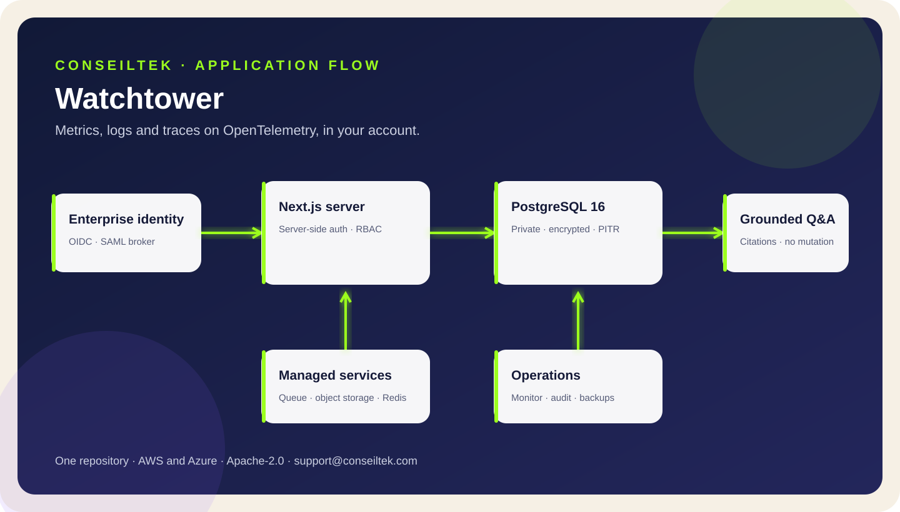
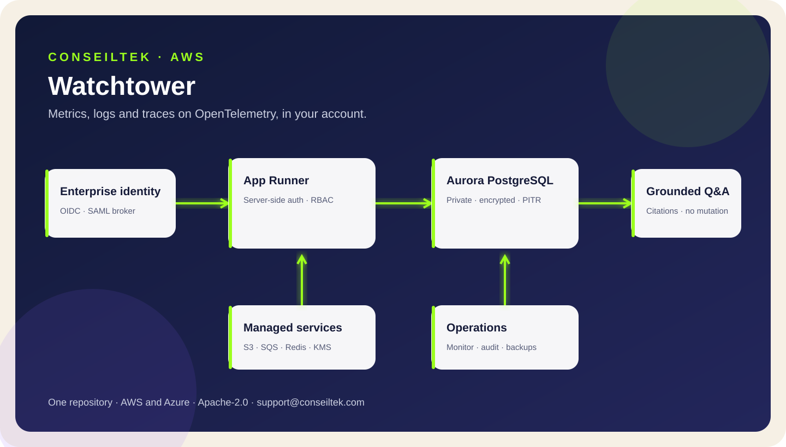

# Watchtower architecture

Watchtower is a server-rendered Next.js application with authenticated route handlers, PostgreSQL as the system of record, Redis for bounded caches and rate limits, object storage for evidence, and a queue for asynchronous work.

## Request and trust flow

1. The user authenticates through OIDC. SAML providers connect through the documented broker pattern.
2. The server maps trusted identity groups to configurable roles and enforces permissions again on every API route.
3. Alert rule writes execute in PostgreSQL transactions with workflow and audit events.
4. Attachments go to private object storage; PostgreSQL stores hashes, classification, and references.
5. Background work is accepted through a managed queue and must be idempotent.
6. Q&A retrieves only authorised workspace context and approved knowledge. It cannot mutate records or approve workflows.

The core operational sequence is to ingest standards-based telemetry, evaluate a reviewed signal, route an alert, and preserve incident context.

## Domain model

Service, TelemetrySource, Dashboard, Query, AlertRule, AlertEvent, SLO, ErrorBudget, Annotation, AuditEvent.

## Production topology

### AWS

The reference deployment uses App Runner for managed application compute, Aurora PostgreSQL Serverless v2, ElastiCache Serverless, S3, SQS, KMS, Secrets Manager, WAF, and CloudWatch. Private data services have no public route.

### Azure

The reference deployment uses Azure App Service Web App for Containers, PostgreSQL Flexible Server, Azure Managed Redis, Blob Storage, Storage Queue, Key Vault, Application Gateway/WAF, and Azure Monitor with private networking.

Static Web Apps and S3 website hosting are intentionally excluded: this application requires authenticated server execution, database transactions, SSO callbacks, and controlled AI retrieval.

## Honest boundary

Watchtower does not provide a proprietary cross-customer anomaly corpus. Storage cost and query performance depend directly on retention, sampling, and cardinality discipline.
